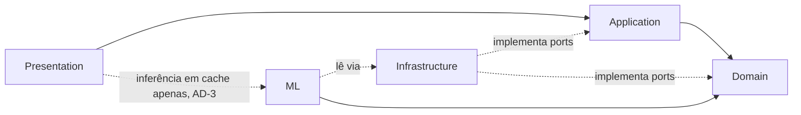
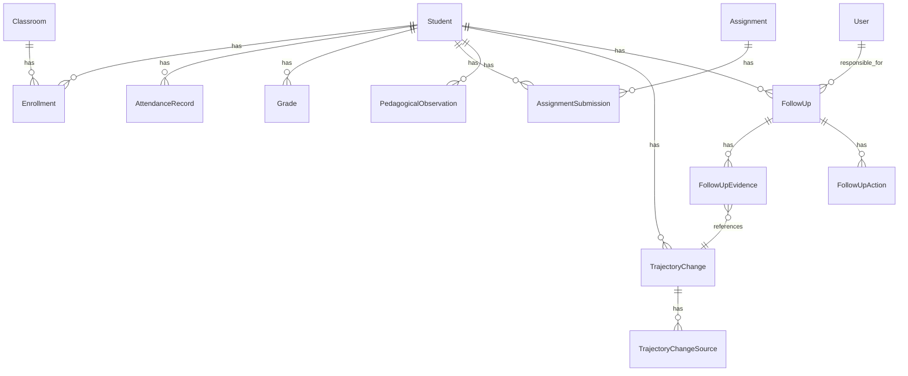

# Architecture Spine — Sinaliza

## Design Paradigm

**Layered Architecture** com regra de dependência de dentro para fora, mais **Pipeline pattern** nos dois pontos do sistema onde uma sequência de transformações precisa ser idêntica em todos os pontos de uso (detecção de sinais; pré-processamento + modelo de ML).

| Camada | Diretório | Depende de | Nunca depende de |
| --- | --- | --- | --- |
| Domain | `backend/app/domain/` | nada (Python puro) | FastAPI, SQLAlchemy, scikit-learn |
| Application | `backend/app/application/` | Domain (via ports/interfaces) | Infrastructure, Presentation, ML |
| Infrastructure | `backend/app/infrastructure/` | Domain, Application (implementa ports) | Presentation |
| Presentation | `backend/app/presentation/` | Application | Domain diretamente, Infrastructure diretamente |
| ML | `backend/app/ml/` | Domain (read-models/ports) | Presentation, Application (não é chamado por rotas ao vivo, ver AD-3) |



## Invariants & Rules

### AD-1 — Trajetória e detecção de mudança são sempre calculadas sob demanda, nunca por job agendado `[ADOPTED]`

- **Binds:** RF-10, RF-11, RF-14, RNF-06, RNF-11, `TrajectorySnapshot`, `TrajectoryChange`, `TrajectoryChangeSource`
- **Prevents:** um worker/cron/Celery-beat recalculando trajetórias em horário fixo; divergência entre o dado acabado de lançar e um snapshot desatualizado; qualquer processo fora do caminho de requisição escrevendo essas tabelas; uma recomputação reescrevendo silenciosamente uma `TrajectoryChange` que um `FollowUp` já cita como evidência; duas requisições concorrentes duplicando a mesma mudança "canônica"
- **Rule:**
  - `TrajectorySnapshot` (chave natural `student_id + snapshot_date + window_days`, já suas próprias colunas) e `TrajectoryChange` são calculados de forma síncrona, dentro da própria requisição HTTP que precisa deles (`GET /home`, `GET /students/{id}/trajectory`), consultando diretamente as tabelas de fatos brutos na janela relevante. Nenhum processo fora do caminho de requisição (nenhum worker, nenhuma fila, nenhum cron) tem permissão de escrever nessas tabelas.
  - **Chave de upsert de `TrajectoryChange`:** `(student_id, type, period_id)` — `period_id` referencia o `AcademicPeriod`/bimestre em que a convergência foi detectada (não `window_days`, que só existe em `TrajectorySnapshot`). Constraint `UNIQUE(student_id, type, period_id)` no banco. A escrita é sempre `INSERT ... ON CONFLICT (student_id, type, period_id) DO UPDATE ...` (nunca `SELECT` seguido de `INSERT`/`UPDATE` em duas etapas) — resolve concorrência entre requisições por construção, sem lock explícito.
  - **Imutabilidade uma vez evidenciada:** se a linha em conflito já tem ao menos um `FollowUpEvidence` apontando para ela, o `ON CONFLICT` é `DO NOTHING` — a mudança fica congelada (descrição, `detected_at` e suas `TrajectoryChangeSource` não mudam mais), porque um acompanhamento já a citou como prova (RF-14, RNF-11). Se ainda não foi evidenciada, o `DO UPDATE` substitui `description`/`detected_at` e a aplicação apaga+reinsere (mesma transação) as linhas de `TrajectoryChangeSource` correspondentes, refletindo a janela atual.
  - **Escopo de transação:** cada estudante recomputado é uma transação própria (nunca uma transação única cobrindo os ~200 alunos de `GET /home`) — falha em um estudante nunca reverte os demais, e mantém locks curtos sob concorrência.
  - **`FollowUpEvidence` nunca é escrita por este caminho.** A detecção (`application/trajectory`) só cria/atualiza `TrajectoryChange` + `TrajectoryChangeSource`. Vincular uma mudança a um acompanhamento é sempre uma ação explícita da coordenação em `application/followup` (RF-13/RF-20) — nunca um auto-attach automático quando uma nova mudança aparece para um `FollowUp` já aberto. Um único módulo escreve `FollowUpEvidence`, evitando duas implementações independentes divergirem sobre anexação automática vs. manual.
  - **"Fator Preocupante" nunca é persistido.** Um sinal isolado que não converge com nenhum outro no mesmo `period_id` (RF-11) é computado e devolvido na mesma resposta HTTP, sem id estável e sem linha em nenhuma tabela — não pode ser citado por `FollowUpEvidence` (não existe FK para apontar). Se, numa requisição futura, esse sinal convergir com outro, ele *vira* uma `TrajectoryChange` real pela regra de upsert acima; até lá, é território puramente efêmero, nunca uma linha "tipo isolado" na mesma tabela de `TrajectoryChange`.
  - **`TrajectoryChange` é evento, não gauge.** Não existe "retração": se os sinais que causaram a convergência deixam de se confirmar num recálculo posterior do mesmo `period_id` (aluno recuperou), a linha já gravada permanece — ela registra que a convergência *aconteceu* naquele bimestre, um fato histórico, não um status ao vivo do estudante. Nenhum caminho de código apaga ou reverte uma `TrajectoryChange` por um recálculo mostrar sinais diferentes agora; recuperação aparece como um novo período sem novo `TrajectoryChange`, nunca como mutação do registro antigo.

### AD-2 — Regra de dependência entre camadas

- **Binds:** todo o backend
- **Prevents:** lógica de domínio importando FastAPI/SQLAlchemy/scikit-learn; dependência circular entre módulos; regra de negócio vazando para dentro de um router HTTP
- **Rule:** ver tabela e diagrama em *Design Paradigm*. `domain/` é Python puro (sem imports de framework). `application/` só enxerga `domain/` e interfaces de repositório (ports) — nunca uma classe concreta de `infrastructure/`. `presentation/` (routers FastAPI) só chama serviços de `application/`, nunca acessa `infrastructure/` ou `domain/` diretamente. `ml/` só lê modelos de domínio/ports, nunca é importado por `presentation/` fora do caminho de inferência em cache (AD-3).

### AD-3 — ML nunca treina dentro do caminho de requisição; inferência ao vivo só usa artefato em cache

- **Binds:** RF-15, RF-16, RF-17, RF-23, RNF-03
- **Prevents:** treino disparado implicitamente por uma requisição HTTP ou no boot do app; recarregar o artefato serializado a cada request; pré-processamento duplicado entre treino e inferência
- **Rule:** treino e avaliação do modelo só rodam via comando CLI offline (`python -m app.ml.train`), disparado manualmente pelo autor — nunca pelo processo web, nunca por scheduler. O `Pipeline` único do scikit-learn (pré-processamento + modelo) é serializado uma vez e reutilizado sem alteração entre treino e inferência (RNF-03). Se/quando existir um endpoint de inferência ao vivo (tela técnica de score — ver Deferred), ele carrega o artefato uma única vez por processo (singleton em memória), nunca recarrega nem retreina por requisição. **"Por processo" pressupõe um único processo Uvicorn (`--workers 1`)** — o backend roda sem múltiplos workers (escala trivial para autor único/~200 alunos, RNF-04 não exige alta concorrência); se um dia precisar de mais de um worker, o cache do artefato deixa de ser singleton único e passa a exigir um cache compartilhado (Deferred), nunca N cópias silenciosas carregadas de forma independente. O score/predição nunca aparece em endpoint ou schema de resposta do produto (`/students/*`, `/follow-ups/*`); vive atrás de um boundary interno separado (`/research/*` ou notebook), nunca junto ao contrato de API do produto.

### AD-4 — Dois recortes de dataset, mesma base, nunca três bases separadas

- **Binds:** RF-23
- **Rule:** `Student.dataset_split` (enum `TRAIN` | `EVAL_DEMO`) particiona a única base Postgres sintética, atribuído na geração sintética (nunca em query time). Toda consulta de treino filtra `= TRAIN`; toda consulta da aplicação web (home, trajetória, acompanhamento, lançamento) filtra `= EVAL_DEMO`; a avaliação offline de métricas (RNF-14) lê `EVAL_DEMO` **sem** esse filtro adicional de truncagem de data (ver AD-5). Nunca existem três bases sintéticas sincronizadas. Enforcement estrutural, não convenção — ver AD-11.
- **Prevents:** vazamento de treino na avaliação/demo; duplicação de bases sintéticas a manter sincronizadas; um endpoint novo esquecer o filtro (o maior raio de explosão da spine, ver AD-11).

### AD-5 — Truncagem "hoje" tem uma única fonte de verdade, e só se aplica ao caminho de serviço ao vivo

- **Binds:** RF-23 (demo ao vivo), RNF-14 (avaliação de ML)
- **Prevents:** o serviço de trajetória e o script de avaliação de ML truncando "hoje" de forma diferente; a avaliação de métricas (RNF-14/SM-4) sendo corrompida por perder exatamente o desfecho que precisa enxergar
- **Rule:** um único utilitário `as_of()` (em `domain/`, variável de override nomeada `SINALIZA_DEMO_AS_OF`) resolve a data de referência — hoje real (UTC) por padrão, sobrescrevível só por essa variável, documentada, para ensaio de demonstração. `as_of()` trunca **apenas** o caminho de leitura da aplicação servindo ao vivo (home, trajetória — via AD-11); **nunca** trunca o script de avaliação de ML (`ml/evaluate`), que lê o recorte `EVAL_DEMO` por inteiro, com desfecho completo, exatamente como RF-23 exige ("trajetória completa e desfecho conhecido"). Truncar a avaliação de métricas seria um erro literal e plausível de aplicar AD-5 fora do seu escopo — por isso a distinção é explícita aqui, não deduzida.

### AD-6 — Status de acompanhamento é enum fechado, histórico é append-only

- **Binds:** RF-12, RF-13, RF-14, RNF-11
- **Prevents:** um quinto status ad-hoc (ex. "HIGH_RISK" ou equivalente); perda de histórico ao mudar de status; edição retroativa de uma ação já registrada
- **Rule:** `FollowUp.status` é um ENUM nativo do Postgres com os 4 valores fechados (`EM_OBSERVACAO`, `ACOMPANHAMENTO_ATIVO`, `AGUARDANDO_RETORNO`, `ENCERRADO`) — nunca coluna de texto livre, para impedir um 5º estado ad-hoc entrar mesmo via patch direto no banco. A transição só acontece através de um método de application service — nunca atribuição direta de campo a partir de um router. Toda mudança de status e todo `FollowUpAction` é inserção append-only; o papel de aplicação (role do Postgres usado pelo backend) tem `GRANT INSERT, SELECT` mas **não** `UPDATE`/`DELETE` em `follow_up_action` — backstop de banco, não só disciplina de código, contra um `UPDATE`/`.delete()` acidental por um caminho de código futuro.

### AD-7 — Integridade de evidência garantida por FK real e por transação, não por overclaim de trigger

- **Binds:** RF-04, RF-09, RF-11, RNF-11
- **Prevents:** `TrajectoryChange` ou `FollowUpEvidence` sem origem rastreável, escapando por só ser validado na camada de aplicação; falta duplicada de presença escapando por só ser validado na camada de aplicação
- **Rule:** `FollowUpEvidence.trajectory_change_id` é FK real, `NOT NULL` (nunca opcional) — genuinamente enforced em nível de schema. A garantia "toda `TrajectoryChange` tem ao menos uma `TrajectoryChangeSource`" não é um trigger de banco (nenhum foi desenhado para o MVP) — é enforced por construção: o único método de application service que escreve `TrajectoryChange` (AD-1) sempre escreve suas `TrajectoryChangeSource` na mesma transação, e nenhum outro caminho de código tem permissão de `INSERT` em `trajectory_change` (mesmo padrão de restrição de privilégio da AD-6). `AttendanceRecord` tem `UNIQUE(student_id, classroom_id, date)` em nível de banco (não só checagem de aplicação) — resolve RF-04 + a consequência testável de RNF-11 ("duplicidade... impedida em nível de banco").

### AD-8 — Perfil único; visibilidade de registro pedagógico escopada por responsável, não por papel novo

- **Binds:** RF-01, RF-02, RF-22, RNF-05, RNF-12
- **Prevents:** introduzir um segundo papel/permissão tipo "professor" (rejeitado explicitamente no brief/PRD); acesso aberto a qualquer registro pedagógico independente de quem abriu o acompanhamento
- **Rule:** um único modelo `User`, sem enum de papel. Senha com hash (bcrypt/argon2), autenticação via JWT bearer stateless.
  - **Isto é uma redação de exibição, nunca um filtro de entrada da detecção.** `SignalEvaluator`/`ConvergenceRule` (AD-1) sempre rodam sobre o conjunto completo e não filtrado de registros pedagógicos do estudante — a mesma `TrajectoryChange` existe para qualquer usuário que a veja, consistente com a chave de upsert de AD-1 ser `student_id`-escopada (não `user_id`-escopada). O filtro de visibilidade só se aplica ao servir o **texto** de um `PedagogicalObservation` para exibição.
  - **Quando o filtro se ativa:** um `PedagogicalObservation` só fica escopado depois de virar fonte de evidência (via `TrajectoryChangeSource` → `TrajectoryChange` → `FollowUpEvidence`) de um `FollowUp` real — antes disso (a maioria dos registros do dia a dia, RF-08), é visível a qualquer usuário autenticado, igual a frequência/nota (hoje há um único perfil — a própria consequência do RF-22 já declara isso). Uma vez vinculado, o texto fica visível à união dos `responsible_user_id` de todos os `FollowUp`s que o citam como evidência (se mais de um acompanhamento cita o mesmo registro histórico, qualquer um dos responsáveis pode vê-lo — nunca exclusivo a um só).
  - A extensão "ou à coordenação pedagógica" citada no RF-22 é preparação estrutural futura (deliberadamente não implementada como uma segunda regra agora — ver Deferred). Enforcement do filtro descrito acima é estrutural, não convenção — ver AD-11.

### AD-9 — Hospedagem: uma única VM sempre ativa, sem scale-to-zero, sem cron; Plano B documentado `[ADOPTED — restrição fixa do usuário]`

- **Binds:** RNF-04, RNF-06, SM-1
- **Prevents:** depender de um free tier de PaaS que hiberna (Render spin-down ~15min/30-60s cold start; Fly.io sem free tier para conta nova desde out/2024) e precisaria de um ping de keep-warm agendado para não violar RNF-01 — o que violaria a própria proibição de cron; comprometer o prazo de 23/11/2026 por depender de um único caminho de provisão sem plano de contingência
- **Rule:** **Plano A:** VM Oracle Cloud "Always Free" Ampere A1 (2 OCPU/12GB após o corte de 2026), rodando `docker-compose` com três serviços (Postgres, FastAPI/Uvicorn, Nginx servindo o build estático do React + reverse proxy `/api`). Nada nessa topologia escala a zero.
  - **Provisionar Ampere A1 é hoje a exceção, não a regra** — múltiplas fontes de 2026 relatam falha por falta de capacidade na maioria das regiões OCI para tenancies novas. Isto não é tratado como risco raro: a arquitetura assume que pode não estar disponível e trata o Plano B abaixo como caminho igualmente esperado, não uma contingência de último caso.
  - **Plano B (se Ampere A1 indisponível na região):** `VM.Standard.E2.1.Micro` (1 OCPU, 1 GB RAM, sempre disponível) rodando a mesma topologia, mas com Postgres `shared_buffers` reduzido, um único worker Uvicorn e swap habilitado — configuração mais apertada, aceitável para ~200 alunos sintéticos/1 ano letivo, sem folga para o artefato de ML em memória (que só carrega sob AD-3, fora do caminho comum).
  - **Plano C (se nenhuma VM Oracle provisionar a tempo do prazo):** Render free (backend, aceita spin-down) + Neon free (Postgres, wake ~300-800ms) + Vercel free (frontend estático) — com um **pré-aquecimento manual** (visitar a URL / *health check* manual alguns minutos antes da demonstração) imediatamente antes da apresentação à banca. É uma ação humana pontual, não um job agendado — não viola RNF-06. Este plano tem RNF-01 (5s) exposto a cold-start em qualquer momento fora do pré-aquecimento, por isso é Plano C, não A.
  - **Robustez do container (Planos A/B):** `docker-compose.yml` fixa `restart: unless-stopped` nos três serviços (recuperação automática após reboot da VM ou crash do processo — sem isso, uma queda do Postgres/Uvicorn vira indisponibilidade permanente até intervenção manual, o que uma VM "sempre ativa" sem supervisor tornaria silencioso) e um volume Docker nomeado para o `PGDATA` do Postgres (dados sobrevivem a `docker compose down`/recriação do container; só um `docker volume rm` explícito apaga, nunca um redeploy de rotina).

### AD-10 — Resolve os dois `[NOTE FOR PM]` deixados em aberto pelo Levantamento de Requisitos aprovado

- **Binds:** RF-03, RF-05
- **Prevents:** modelagem ambígua de falta (justificada vs. não) e de nota (escala/semântica) vazando para a regra de detecção sem uma decisão explícita e documentada
- **Rule:** `AttendanceRecord.status` é um enum (`PRESENT`, `ABSENT_JUSTIFIED`, `ABSENT_UNJUSTIFIED`), não mais um booleano `present` — mas RF-11 conta toda falta igualmente (justificada + não justificada) no cálculo de tendência no MVP, por simplicidade; o campo de justificativa é gravado para uso futuro, não usado na matemática de detecção ainda. `Grade.value` é `numeric(4,2)` em escala 0.0–10.0, sem campo de aprovação/reprovação — nenhum RF exige essa semântica.

### AD-11 — Invariantes de leitura (as_of, dataset_split, visibilidade de registro pedagógico) são enforced por um único repositório-base, nunca por convenção espalhada

- **Binds:** AD-4, AD-5, AD-8 — todo o backend que lê fatos ou registros pedagógicos
- **Prevents:** "toda query deve lembrar de filtrar X" como único mecanismo — um endpoint novo (escrito numa sessão diferente, por um agente diferente) esquecendo o filtro e reintroduzindo vazamento de treino/dado de futuro/registro pedagógico de outro responsável
- **Rule:** existe uma única classe-base de repositório (`application`/`infrastructure`) cujo método de leitura padrão já aplica `dataset_split = EVAL_DEMO` e `as_of()` a toda consulta de fatos — esse é o caminho default, não opt-in. Só `ml/train` e `ml/evaluate` (processos CLI offline, AD-3) usam uma classe de repositório explicitamente diferente (`TrainingRepository`/`EvaluationRepository`) que lê `TRAIN` sem truncagem ou `EVAL_DEMO` sem truncagem (AD-5) — nunca a mesma classe usada pelo caminho web. O filtro de visibilidade de registro pedagógico (AD-8) vive no mesmo método de leitura de `PedagogicalObservation`, nunca inline em cada endpoint.

### AD-12 — Contrato do pipeline de detecção de sinais; cálculo de indicadores é função pura em `domain/`

- **Binds:** RF-10, RF-11
- **Prevents:** cada `SignalEvaluator` (frequência, nota, atividades, registro pedagógico) devolvendo um formato diferente, incompatível com o `ConvergenceRule` que os combina; a matemática de tendência (RF-10) sendo reimplementada de forma diferente por quem constrói o serviço de trajetória e por uma futura etapa de feature engineering de ML que precise "da mesma" tendência
- **Rule:** `SignalEvaluator.evaluate(student_id, period_id) -> Signal(confirmed: bool, kind: str, source_ids: list[SourceRef])` é a interface fixada para os quatro avaliadores (frequência, nota, atividades, registro pedagógico); `ConvergenceRule.evaluate(signals: list[Signal]) -> TrajectoryChange | None` combina ≥2 `Signal.confirmed=True` independentes no mesmo `period_id` (o limiar exato continua `[ASSUMPTION]` do PRD, ver Deferred — só a forma é fixada aqui). O cálculo de indicadores brutos (`attendance_rate`, `attendance_trend`, `grade_trend`, etc., RF-10) é função pura em `domain/trajectory.py`, sem I/O — testável isoladamente (RNF-09) e reutilizável por qualquer futura etapa de feature engineering de ML sem reimplementar a fórmula.

## Consistency Conventions

| Concern | Convention |
| --- | --- |
| Naming (entidades, arquivos, eventos) | Entidades em inglês, PascalCase, idênticas a `docs/data-model.md` (`Student`, `TrajectoryChange`, `FollowUp`...). Tabelas Postgres em snake_case plural. Rotas REST em inglês, kebab/plural (`/students/{id}/trajectory`, `/follow-ups/{id}`). O termo "professor" nunca aparece em identificador de produto ou código (regra explícita do PRD/addendum) — usar `User`/`responsible_user_id`. |
| Dados & formatos (ids, datas, erros) | PK = UUID v4. Datas de fato (`due_date`, `period.start_date`) como `date`; timestamps de auditoria (`created_at`) como `timestamptz` UTC. Envelope de erro `{ "error": { "code": str, "message": str } }`; sucesso é o recurso JSON puro, sem wrapper. |
| Estado & cross-cutting (mutação, auth, config, migrations) | Migrations via Alembic, nunca alteração de schema manual. Auth: JWT bearer stateless (sem sessão server-side). Config via variáveis de ambiente (`pydantic-settings`), nunca segredo hardcoded. `as_of()` é a única fonte de "hoje" (AD-5). Toda mutação de estado passa por um método de application service, nunca atribuição direta de campo a partir de um router (AD-6 generaliza para toda entidade com estado, não só `FollowUp`). |
| Geração de tipos do frontend | Tipos TypeScript do cliente HTTP (`frontend/src/api/`) gerados a partir do schema OpenAPI do FastAPI, nunca transcritos à mão a partir da prosa do PRD — evita descolamento entre os literais de enum em português do PRD/glossário (ex. "em observação") e os valores reais do enum no banco (`EM_OBSERVACAO`). |
| `FollowUp.next_review_date` | Consumido só por uma query ao vivo em `GET /home` (`WHERE next_review_date <= as_of()`) — nunca por um job/lembrete agendado, o que violaria AD-1/AD-9. |

## Stack

<!-- Verificado na web em 2026-09-17. -->

| Name | Version |
| --- | --- |
| Python | 3.14.x (estável corrente; scikit-learn 1.9.1 já suporta) |
| FastAPI | 0.141.x |
| PostgreSQL | 18.6 (self-hosted na VM — sem constraint de provider gerenciado) |
| SQLAlchemy | 2.x |
| Alembic | 1.x (par de SQLAlchemy 2.x) |
| scikit-learn | 1.9.x |
| React | 19.3.x (`[ASSUMPTION]` sem Next.js — ver nota abaixo) |
| Vite | 8.x |
| Node.js | 24.x LTS Ativa (build do frontend; 22.x é LTS de Manutenção, não a escolha corrente) |
| Docker / docker-compose | atual estável, para deploy na VM |
| Oracle Cloud Always Free VM | Ampere A1 (2 OCPU/12GB, Plano A) ou `VM.Standard.E2.1.Micro` (1 OCPU/1GB, Plano B — ver AD-9) |

`[ASSUMPTION]` RNF-06 (texto preservado do Levantamento aprovado) cita "front-end em React/Next.js". Esta spine fixa **React puro (Vite, SPA)**, sem Next.js — porque (a) o usuário fixou "React" sem "Next.js" nesta invocação de arquitetura, e (b) AD-9 já serve tudo como estático atrás de um único Nginx numa VM sempre ativa, o que remove a motivação original de Next (SSR/edge/deploy Vercel) e evitaria dobrar a superfície de cold-start exatamente onde a restrição de hospedagem gratuita é mais apertada. Sinalizado para confirmação do autor; reverter para Next.js é uma mudança de uma linha nesta tabela se a decisão não for aceita.

## Structural Seed

```text
sinaliza/
  backend/
    app/
      domain/            # entidades, value objects, SignalEvaluator/ConvergenceRule, as_of() — Python puro
      application/        # use-cases (abrir acompanhamento, registrar observação, calcular trajetória), ports (interfaces de repositório)
      infrastructure/      # modelos SQLAlchemy, repositórios (implementam os ports), Alembic
      presentation/        # routers FastAPI, schemas Pydantic, injeção de dependência
      ml/                  # pipeline scikit-learn, feature engineering, CLI de treino/avaliação (offline, ver AD-3)
      synthetic/            # gerador determinístico de dataset sintético (CLI), perfis, constantes de calibração (RNF-13)
    tests/
    alembic/
    Dockerfile
  frontend/
    src/
      pages/              # Home, StudentTrajectory, FollowUp, Launch (chamada/nota/entrega/observação)
      components/          # trajectory-chart, evidence-card, calm-state-card, factor-preocupante, followup-status-pill (ver DESIGN.md)
      api/                  # cliente HTTP tipado
    Dockerfile
  docker-compose.yml       # postgres + backend + nginx (frontend estático + reverse proxy /api)
  docs/
```



## Capability → Architecture Map

| Capability / Área (PRD) | Vive em | Governado por |
| --- | --- | --- |
| §4.1 Autenticação e Acesso (RF-01, RF-02) | `presentation/auth`, `domain/user` | AD-8 |
| §4.2-4.4 Frequência/Notas/Atividades (RF-03..RF-07) | `application/records`, `infrastructure/repositories` | AD-2, AD-7, AD-10, Consistency Conventions |
| §4.5 Registros Pedagógicos (RF-08, RF-09) | `application/records`, `domain` | AD-7, AD-8, AD-11 |
| §4.6 Trajetória (RF-10, RF-11) | `domain` (SignalEvaluator/ConvergenceRule/indicadores), `application/trajectory` | AD-1, AD-5, AD-7, AD-11, AD-12 |
| §4.7 Acompanhamento (RF-12..RF-14) | `application/followup`, `domain/followup` | AD-1, AD-6, AD-7 |
| §4.8 Privacidade e Acesso (RF-22) | `application/records` (filtro de leitura) | AD-8, AD-11 |
| §4.9 Machine Learning (RF-15..RF-17, RF-23) | `ml/` (offline), `domain` (read-models) | AD-3, AD-4, AD-5, AD-11 |
| §4.10 Interface (RF-18..RF-21) | `frontend/src/pages` | DESIGN.md, EXPERIENCE.md (companion) |
| RNF-02 Usabilidade responsiva, RNF-08 Acessibilidade, RNF-10 Compatibilidade | `frontend/src/components` | DESIGN.md, EXPERIENCE.md (companion) — altitude de UX, não desta spine |
| RNF-06 Hospedagem | `docker-compose.yml`, deploy da VM | AD-9 |
| RNF-07 Dados exclusivamente sintéticos, RNF-13 Origem/governança | `synthetic/` | AD-4, research.md (companion) |
| RNF-09 Manutenibilidade/testes | `tests/`, camadas de `backend/app/` | AD-2, AD-12, AGENTS.md §Testes |
| RNF-14 Fronteira do score/avaliação ML | `ml/evaluate`, docs de avaliação | AD-3, AD-5, AGENTS.md §Avaliação de ML |

## Deferred

- **Limiar exato de convergência de sinais** — já é `[ASSUMPTION]` do próprio PRD (RF-11: confirmação/persistência/coincidência de ≥2 sinais no mesmo bimestre); esta arquitetura só fixa a forma (`SignalEvaluator` por sinal + `ConvergenceRule`, AD-12), não o valor exato, a calibrar quando a base sintética existir.
- ~~**Tela técnica de visualização do score**~~ — **Decidido (PRD §9, item 2, atualizado 2026-09-23): não é construída no MVP.** O relatório de `python -m app.ml.evaluate` (Story 5.3, RNF-14) é o artefato de avaliação acadêmica/pesquisa; nenhum boundary de leitura novo além do já especificado em `docs/epics.md`. Racional original preservado como contexto: se viesse a ser construída, seria leitura read-only de `MLPrediction` já persistido por AD-3, sem novo pipeline nem inferência ao vivo fora do padrão de cache já fixado.
- **Log de acesso aos registros pedagógicos** (Should, §6.2) — fora desta spine; se houver tempo até 23/11/2026, entra como tabela de auditoria append-only sobre o mesmo padrão de AD-6/AD-7.
- **Carve-out de visibilidade "coordenação pedagógica" além de `responsible_user_id`** (RF-22) — deliberadamente não implementado agora (ver AD-8); revisitar apenas se o produto real ganhar múltiplos usuários com necessidade de visão cruzada.
- **DNS/domínio da VM Oracle** — usar IP público ou um DNS dinâmico gratuito (ex. DuckDNS); decisão de deploy, não de arquitetura.
- **Processo de deploy** — SSH manual + `git pull` + `docker compose up --build` é suficiente para um autor único sem CI; aceitável não formalizar um pipeline de CI/CD dado o prazo. Revisitar só se o repositório ganhar colaboradores.
- **Backup/restore do Postgres único** — não coberto nesta spine; risco real dado que há uma única instância sem rede de segurança de provider gerenciado. Mínimo recomendado antes da entrega: `pg_dump` manual periódico (ex. antes de cada sessão de trabalho relevante) para fora da VM — não é um cron da aplicação, é disciplina do autor, então não viola AD-9.
- **Monitoramento/acesso a log da VM** — não coberto; para o escopo de TCC, acesso via SSH + `docker compose logs` é suficiente; sem dashboard de observabilidade.
- **Ambientes (dev local vs. VM)** — o mesmo `docker-compose.yml` roda localmente (dev) e na VM (produção/demo); não há ambiente de staging separado, aceitável para autor único.
- **Otimização de cache para o fan-out da Home** (~200 alunos recalculados por requisição, AD-1) — começar com cálculo ao vivo puro, escala trivial para ~200 alunos/1 ano letivo com agregação set-based (nunca loop Python por aluno); só otimizar se medição real mostrar risco à RNF-01 (5s). Qualquer otimização futura (cache em memória, view materializada) continua proibida de ser recalculada por job agendado/worker assíncrono — permanece sob AD-1/AD-9; a única forma aceitável de "acelerar" é reduzir custo por requisição, nunca mover o recálculo para fora do caminho de requisição.
- **Distribuição sintética de notas 0-10 e frequência diária** — sem base pública brasileira equivalente (ver research.md, Perguntas em aberto); permanece suposição de design documentada no gerador sintético (`synthetic/`), não dado calibrado, com proveniência registrada por parâmetro (fonte + confiança) conforme a Recomendação 5 da pesquisa.
